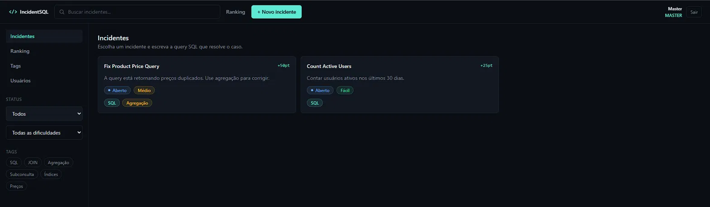

# </> IncidentSQL

> Resolva incidentes, um SELECT por vez.

Plataforma gamificada de desafios SQL. MASTERs criam incidentes com cenários reais, USERs resolvem escrevendo a query correta e sobem no ranking.



---

## Funcionalidades

- **Autenticação** — registro e login com roles `MASTER` e `USER`
- **Incidentes** — criação com schema SQL, query de resposta e pontuação
- **Validação de SQL** — a query do usuário é comparada com a resposta definida pelo MASTER
- **Ranking** — placar com pontos acumulados por incidentes resolvidos
- **Tags** — categorização de incidentes (gerenciado por MASTERs)
- **Gestão de usuários** — MASTERs podem promover ou rebaixar qualquer usuário

---

## Roles

| Role | Permissões |
|------|-----------|
| `MASTER` | Criar, editar e excluir incidentes · Gerenciar tags · Gerenciar usuários |
| `USER` | Visualizar e resolver incidentes · Ver ranking |

Credencial MASTER padrão (desenvolvimento): `master@incidentsql.com` / `master123`

---

## Stack

**Frontend**
- React 19 + TypeScript
- Vite + Tailwind CSS v4
- React Router v7

**Backend**
- Python 3.11+
- FastAPI + Uvicorn
- Supabase (banco de dados)

---

## Instalação

### Pré-requisitos

- Node.js 20+
- Python 3.11+
- Conta no [Supabase](https://supabase.com) (opcional — funciona com mock em memória)

### Frontend

```bash
cd support-repository
npm install
npm run dev
```

### Backend

```bash
cd support-repository-api
pip install -r requirements.txt
uvicorn app.main_new:app --port 3001
```

> Use `--reload` apenas em desenvolvimento. Sem ele, os dados em memória persistem enquanto o servidor estiver rodando.

### Variáveis de ambiente

Copie `.env.example` para `.env` e preencha:

```env
SUPABASE_URL=https://seu-projeto.supabase.co
SUPABASE_SECRET_KEY=sua_secret_key
PORT=3001
```

Sem as variáveis do Supabase, a API roda com dados mock em memória.

---

## Estrutura do projeto

```
support-repository/         # Frontend
└── src/
    ├── components/         # UI reutilizável (cards, modals, inputs, SQL)
    ├── contexts/           # AuthContext, IncidentContext, ModalContext, SearchContext
    ├── models/             # Tipos TypeScript
    ├── pages/              # Home, Ranking, Tags, Users, Login
    └── services/           # Chamadas à API

support-repository-api/     # Backend
└── app/
    └── api/
        ├── auth.py         # Registro, login, sessões
        ├── users.py        # Gestão de roles
        ├── incidents_new.py
        ├── tags_new.py
        └── ranking_new.py
```

---

## Como funciona a validação de SQL

Ao criar um incidente, o MASTER define uma **query de resposta correta**. Quando um USER tenta resolver, a query enviada é normalizada (lowercase, espaços colapsados, `;` removido) e comparada com a resposta esperada. Se bater, o incidente é marcado como resolvido e os pontos são creditados.

---

## Deploy

| Serviço | Uso |
|---------|-----|
| [Vercel](https://vercel.com) | Frontend (grátis) |
| [Render](https://render.com) ou [Railway](https://railway.app) | Backend (grátis/pago) |
| [Supabase](https://supabase.com) | Banco de dados (grátis) |
